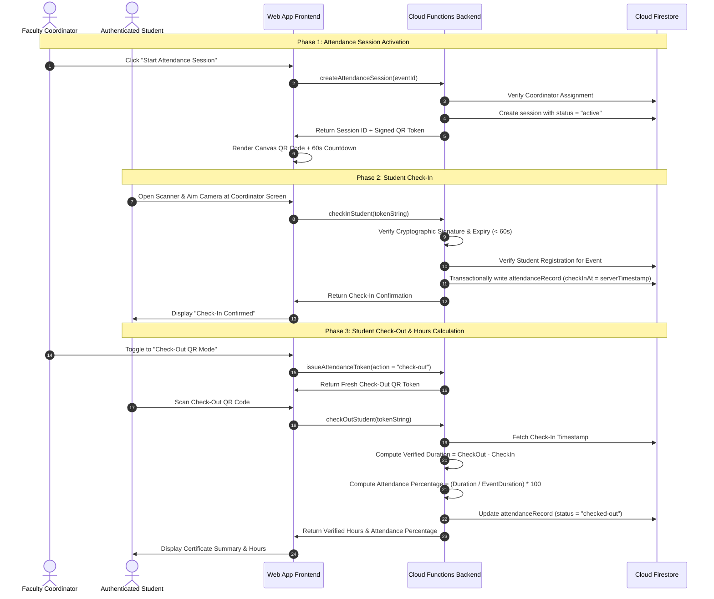

# Attendance State Machine & Verification Workflow

## 1. The Verification Sequence

## 2. Attendance Record State Machine
- `not_checked_in`: Student registered for the event; has not scanned active check-in token.
- `checked-in`: Student scanned valid check-in token; start timestamp captured.
- `checked-out`: Student scanned valid check-out token; verified duration calculated and attendance percentage locked.
- `incomplete`: Event concluded but student never scanned checkout. Incomplete records count zero verified duration unless an authorized administrative correction is applied.
- `rejected`: Scan rejected due to expired token, invalid signature, or unregistered student.
