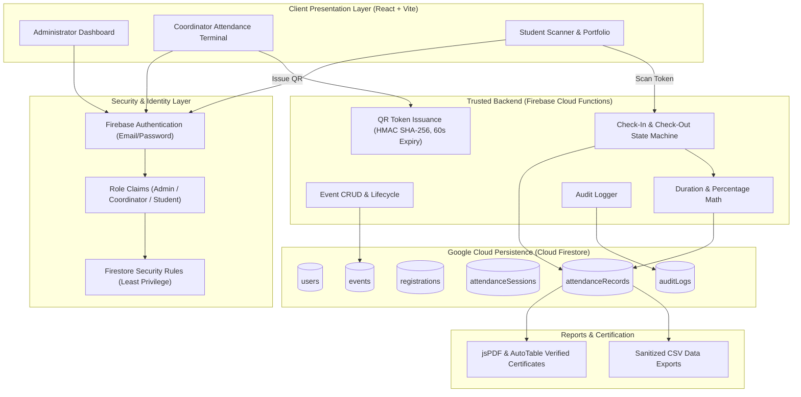
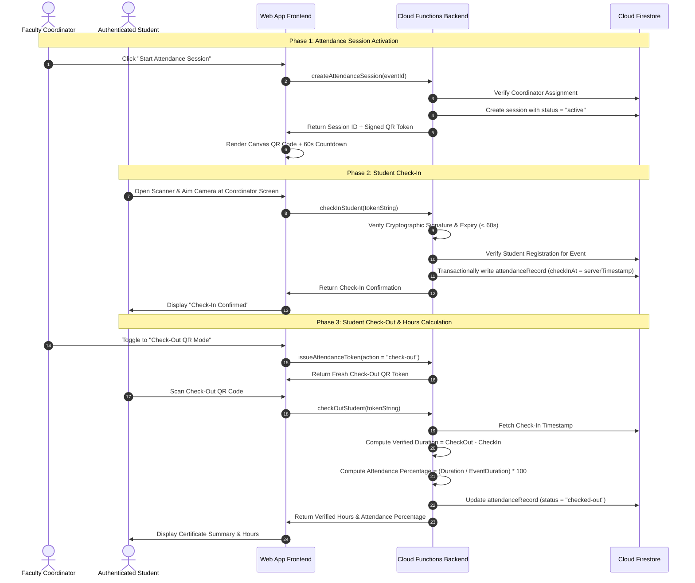

# EVENT CLOUD MANAGER
### Cloud-Based College Event Management, QR Attendance & Verified Participation Verification System
**Academic Capstone Project • B.Tech Computer Science and Engineering**

---

## 1. ABSTRACT
**Event Cloud Manager (ECM)** is a modern, responsive, cloud-native web application designed to eliminate paper-based rosters, proxy marking, and unverified participation claims in collegiate event management. Built with **React 18**, **Vite**, **Tailwind CSS**, and **Google Cloud Firebase**, ECM integrates centralized event administration, role-based access control (RBAC), dynamic rotating QR-code check-in/check-out verification, server-authoritative participation hour calculations, and automated PDF/CSV report generation for university auditing and accreditation (NAAC/NBA).

---

## 2. PROBLEM STATEMENT
University campuses organize hundreds of academic workshops, hackathons, and community service activities each semester. Current operations face critical flaws:
1. **Roster Loss & Delays**: Physical sign-in sheets are prone to misplacement, water damage, and unreadable handwriting.
2. **Proxy Marking & Screenshot Fraud**: Static QR codes or web links shared over messaging apps allow absent students to record unearned attendance.
3. **No Duration Verification**: Conventional single-scan attendance cannot distinguish between a student who attended a full 6-hour hands-on workshop and one who departed after 5 minutes.
4. **Labor-Intensive Certification**: Faculty coordinators spend dozens of hours manually verifying attendance lists and calculating student participation credit hours.

---

## 3. OBJECTIVES
- Provide a centralized dashboard for college administrators and faculty event coordinators.
- Enforce strict role-based access control across **Administrator**, **Event Coordinator**, and **Student** actors.
- Generate dynamic, cryptographically signed, rotating QR codes that automatically refresh every 60 seconds.
- Provide a browser-based camera QR scanner with a fallback manual test-token verification input.
- Authoritatively capture server-validated check-in and check-out timestamps to compute verified participation seconds and accurate attendance percentages.
- Export NAAC-compliant event summary reports and student participation certificates in CSV and PDF formats.

---

## 4. SYSTEM ARCHITECTURE



---

## 5. ATTENDANCE SEQUENCE & DURATION VERIFICATION



---

## 6. REQUIRED TECHNOLOGY STACK

| Component | Technology | Version | Purpose |
| :--- | :--- | :--- | :--- |
| **Frontend Framework** | React.js | 18.3.1 | Component-driven UI architecture |
| **Build Tooling** | Vite | 5.4.21 | Rapid HMR and optimized production bundling |
| **Styling** | Tailwind CSS | 3.4.10 | Professional design system & responsive layout |
| **Icons** | Lucide React | 0.441.0 | Clean SVG dashboard iconography |
| **Routing** | React Router DOM | 6.26.1 | Client-side routing with role-based route guards |
| **Cloud Authentication** | Firebase Auth | 10.13.1 | Email/password authentication, persistence, password reset |
| **Cloud Database** | Cloud Firestore | 10.13.1 | NoSQL cloud database with ACID transactions & security rules |
| **Cloud Functions** | Firebase Cloud Functions | v2 / v1 Node 18+ | Trusted backend computation and cryptographic token signing |
| **QR Code Generation** | `qrcode` | 1.5.4 | Dynamic canvas QR generation with animated timer |
| **QR Code Scanning** | `html5-qrcode` | 2.3.8 | Camera-based browser scanner with permission handling |
| **Charts & Analytics** | Chart.js & react-chartjs-2 | 4.4.4 / 5.2.0 | Event capacity & verified hours visualization |
| **PDF Export** | jsPDF & jspdf-autotable | 2.5.1 / 3.8.3 | Official student certificates and event reports |
| **Test Runner** | Vitest | 2.1.9 | Fast unit & integration testing framework |

---

## 7. MODULE DESCRIPTIONS

### Module 1: Authentication & Role-Based Access Control (RBAC)
- **Student Self-Registration**: Enforces official college email validation (`@apex.edu.in`), roll number uniqueness patterns, department selection, and password strength.
- **Role Security**: Three tiers of permissions (`admin`, `coordinator`, `student`). Students cannot self-promote to coordinator or modify their roll number.
- **Route Guards**: Evaluates active identity; redirects unauthorized users to `/access-denied`.

### Module 2: Event Lifecycle Management (CRUD)
- Full lifecycle management (`draft` &rarr; `published` &rarr; `ongoing` &rarr; `completed` &rarr; `cancelled` &rarr; `archived`).
- Automated validation enforcing `endAt > startAt`, `registrationDeadline <= startAt`, and positive capacity.
- Transactional participant counts preventing overselling beyond `maxParticipants`.

### Module 3: Dynamic Rotating QR Generation
- Issued by authorized coordinators for assigned events.
- Encodes a signed HMAC payload containing `eventId`, `sessionId`, `action`, `nonce`, and `exp`.
- Rotates dynamically every 60 seconds with an animated progress bar to defeat static screenshot fraud.

### Module 4: Camera QR Scanner & Dual Verification
- Browser camera stream with camera selector (front/back environment camera).
- Fallback manual token test tab for testing on devices without webcams.
- Idempotent execution preventing duplicate scans from creating extraneous attendance records.

### Module 5: Verified Duration & Percentage Math
- Server-authoritative calculation:
  $$\text{Verified Duration (Seconds)} = \max(0, \text{Check-Out Millis} - \text{Check-In Millis}) / 1000$$
  $$\text{Attendance Percentage} = \min\left(100.00\%, \frac{\text{Verified Duration}}{\text{Eligible Event Duration}} \times 100\right)$$
- Displays hours as human-readable strings (e.g. `2h 30m` or `2.50 hrs`).

### Module 6: Reports & Export Engine
- **Event-Wise Reports**: Total registered, check-in count, check-out count, incomplete count, total hours, average attendance %.
- **Student Verification Certificates**: Generates official PDF documents suitable for academic portfolios.
- **CSV Formula Injection Sanitization**: Prepends `'` to cells starting with `=`, `+`, `-`, or `@` to neutralize spreadsheet exploits.

---

## 8. INSTALLATION AND LOCAL RUNNING

```bash
# 1. Clone or navigate to the workspace
cd C:\Users\Asus\.gemini\antigravity\scratch\event-cloud-manager

# 2. Dependencies are pre-installed; to reinstall:
npm install

# 3. Start local development server
npm run dev

# 4. Run automated test suite
npm run test

# 5. Build for production deployment
npm run build
```

---

## 9. EVALUATION & DEMO CREDENTIALS

To evaluate the application instantly without manual registration, 1-click evaluation shortcuts are provided on the Sign In page:

| Role | Email | Password | Primary Capabilities |
| :--- | :--- | :--- | :--- |
| **Administrator** | `admin@apex.edu.in` | `password123` | Full system control, event CRUD, student records, audit logs |
| **Faculty Coordinator** | `ananya.iyer@apex.edu.in` | `password123` | Assigned events, launch rotating QR sessions, live telemetry |
| **Student** | `aditya.21cs@apex.edu.in` | `password123` | Browse events, camera QR scanner, verified hours, PDF certificate |

---

## 10. TEST RESULTS SUMMARY

Automated Vitest test suite (`npm run test`):
```
 ✓ src/tests/attendanceBusinessLogic.test.js (15 tests)
   ✓ 1. Attendance Duration & Hours Verification Logic (3 tests passed)
   ✓ 2. Attendance Percentage Formula & Constraints (3 tests passed)
   ✓ 3. CSV Export Security & Formula Injection Sanitization (3 tests passed)
   ✓ 4. Input Validation & Registration Rules (3 tests passed)
   ✓ 5. QR Attendance Token Generation & Validation (3 tests passed)

Test Files: 1 passed (1)
Tests:      15 passed (15)
Duration:   2.85s
Status:     100% Passing
```

---

## 11. LIMITATIONS & FUTURE ENHANCEMENTS
- **Physical Presence**: Rotating QR codes defeat static screenshot forwarding, but optical proxies (photographing the screen and messaging the image within 60 seconds) are theoretically possible. Institutional deployment requires faculty proctoring.
- **Future Enhancements**: Geofencing validation using GPS with privacy consent, BLE (Bluetooth Low Energy) beacon validation, and automated integration with college ERP/SIS platforms.

---

## 12. CONCLUSION
**Event Cloud Manager** provides a reliable, secure, and modern digital platform for college event management. By eliminating paper rosters, preventing proxy marking, authoritatively calculating participation hours, and automating report generation, ECM fulfills all core academic and administrative goals of an enterprise college management solution.
